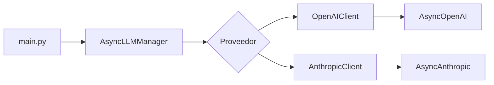

# Unified Async LLM Client

Implementación de un cliente de LLM asíncrono para la **Pre-entrega 1 del curso de AI Engineering**, desarrollado con **Python 3.14**.

El proyecto permite utilizar OpenAI o Anthropic mediante una interfaz común, validar los mensajes y la configuración con Pydantic, generar respuestas completas y recibir texto progresivamente mediante streaming.

## Funcionalidades

- **Proveedores intercambiables:** adaptadores para los SDK oficiales `AsyncOpenAI` y `AsyncAnthropic`.
- **Llamadas asíncronas:** generación mediante `async` y `await`.
- **Streaming:** generadores asíncronos que entregan fragmentos de texto con `yield` y se consumen con `async for`.
- **Validación con Pydantic:** esquemas para mensajes, parámetros del modelo y respuestas completas.
- **Configuración por entorno:** selección de proveedor, modelo y credenciales mediante variables de entorno y un archivo `.env`.
- **Errores controlados:** manejo de autenticación, rate limiting, cuota, conexión y otros errores de API.
- **Control de concurrencia:** semáforo compartido para generación normal y streaming.
- **Gestión de recursos:** cierre de clientes al salir del contexto asíncrono.

## Requisitos

- **Python 3.14**.
- Un entorno virtual y `pip`.
- Dependencias: `openai`, `anthropic`, `pydantic` y `python-dotenv`.
- Para utilizar un proveedor, una API key válida y acceso al modelo configurado.

## Instalación

Ejecutar los siguientes comandos desde la raíz del proyecto, en PowerShell.

### 1. Crear y activar el entorno virtual

```powershell
py -3.14 -m venv .venv
.\.venv\Scripts\Activate.ps1
python --version
```

La versión debe ser Python 3.14.x. Si ya se dispone de un entorno virtual con esa versión, basta con activarlo.

### 2. Instalar las dependencias

```powershell
python -m pip install -r .\requirements.txt
```

### 3. Crear la configuración local

Si el archivo `config/.env` todavía no existe, crear su carpeta y copiar el ejemplo:

```powershell
New-Item -ItemType Directory -Path .\config -Force
Copy-Item .\.env.example .\config\.env
```

Completar las variables del proveedor que se utilizará. Mantener las credenciales únicamente en el entorno o en el archivo `.env`, que está excluido de Git mediante `.gitignore`.

## Variables de entorno

| Variable | Descripción | Requerida |
|---|---|---|
| `LLM_PROVIDER` | Proveedor seleccionado: `openai` o `anthropic`. El valor predeterminado es `openai`. | No |
| `OPENAI_API_KEY` | Clave de acceso a OpenAI. | Al utilizar OpenAI |
| `OPENAI_MODEL` | Identificador del modelo de OpenAI. | Al utilizar OpenAI |
| `ANTHROPIC_API_KEY` | Clave de acceso a Anthropic. | Al utilizar Anthropic |
| `ANTHROPIC_MODEL` | Identificador del modelo de Anthropic. | Al utilizar Anthropic |

El archivo `.env.example` de la raíz contiene la estructura de configuración sin credenciales. `main.py` carga `config/.env` usando una ruta relativa a su propia ubicación, independientemente de la carpeta de ejecución. Las variables ya definidas en el entorno tienen prioridad sobre las del archivo.

## Ejecución del script de demostración

### Sin credenciales ni llamadas a APIs

Usar `--mock` para ejecutar la demostración con respuestas simuladas. Este modo recorre los mismos adaptadores, manager y esquemas utilizando un SDK local. No requiere API keys ni configuración de modelos.

```powershell
python .\main.py openai --mock
python .\main.py anthropic --mock
```

La salida identifica el modo mock y muestra una respuesta fija sobre entropía, tanto completa como en streaming. Esta simulación comprueba el flujo local; el texto no lo genera un modelo de lenguaje.

### Con los SDK oficiales

Con el entorno virtual activado, ejecutar desde la raíz del proyecto:

```powershell
# Utilizar el proveedor configurado en LLM_PROVIDER.
python .\main.py

# Seleccionar OpenAI.
python .\main.py openai

# Seleccionar Anthropic.
python .\main.py anthropic
```

El argumento de consola tiene prioridad sobre `LLM_PROVIDER`.

El script realiza la pregunta **«¿Qué es la entropía?»** en dos modalidades:

1. **Generación normal:** espera la respuesta completa y muestra su texto.
2. **Streaming:** realiza otra consulta y muestra los fragmentos a medida que llegan.

En modo real son dos solicitudes independientes al proveedor seleccionado. Sus respuestas pueden variar. Los comandos sin `--mock` utilizan los SDK oficiales y requieren las credenciales correspondientes.

## Arquitectura

| Componente | Responsabilidad |
|---|---|
| `ChatMessage` | Define y valida los mensajes de entrada: `role` y `content`. |
| `ModelConfig` | Define y valida `model`, `temperature` y `max_tokens`. |
| `ModelResponse` | Unifica la respuesta completa con `text`, `provider` y `model`. |
| `BaseLLMClient` | Define el contrato común de generación, streaming y cierre. |
| `OpenAIClient` | Convierte mensajes y respuestas para el SDK de OpenAI. |
| `AnthropicClient` | Convierte mensajes y respuestas para Anthropic y separa las instrucciones de sistema. |
| `AsyncLLMManager` | Selecciona el proveedor, delega las llamadas y controla la concurrencia. |
| `handle_api_errors()` | Traduce errores de los SDK a excepciones propias. |
| `main.py` | Carga la configuración y ejecuta la demostración en ambos modos. |



## Validación y configuración del modelo

Los esquemas de `schemas.py` establecen las siguientes reglas:

| Campo | Regla | Valor predeterminado |
|---|---|---|
| `role` | `system`, `user` o `assistant`. | Obligatorio |
| `content` | Cadena de texto. | Obligatorio |
| `model` | Cadena con el identificador del modelo. | Obligatorio |
| `temperature` | Número entre `0` y `2`, inclusive. | `0.7` |
| `max_tokens` | Entero mayor que cero. | `512` |

La configuración se construye en `main.py` antes de crear el manager. `ModelConfig` valida `temperature` para ambos proveedores, pero **solo OpenAI aplica ese valor**, tanto en la generación normal como en streaming. `AnthropicClient` omite el parámetro en ambos modos porque `messages.create()` no lo admite en la versión del SDK de Anthropic usada por el proyecto. Al cambiar a Anthropic, ajustar `temperature` no tiene efecto en la respuesta.

## Generación normal y streaming

Los dos proveedores exponen el mismo contrato:

```python
# Respuesta completa: devuelve ModelResponse.
response = await manager.generate(messages, config)
print(response.text)

# Streaming: entrega fragmentos de texto progresivamente.
async for text in manager.stream(messages, config):
    print(text, end="", flush=True)

print()
```

Este ejemplo representa el consumo dentro de una función asíncrona con el manager ya creado. `flush=True` permite mostrar cada fragmento inmediatamente en la terminal. Los fragmentos no corresponden necesariamente a tokens individuales.

## Manejo de errores y recursos

Las excepciones propias se definen en `errors.py`:

- `LLMAuthenticationError`: credenciales rechazadas por el proveedor.
- `LLMRateLimitError`: límite de solicitudes o cuota alcanzado.
- `LLMNetworkError`: errores de conexión o timeout.
- `LLMClientError`: clase base y otros errores de API.

`main.py` captura estos errores y los de configuración o validación para mostrar un mensaje controlado. La ejecución devuelve código `0` al finalizar correctamente y `1` ante un error esperado.

Ambos SDK se configuran con `timeout=30.0` y `max_retries=2`. El timeout corresponde a las esperas de red; los reintentos pueden extender la duración total de la consulta.

El manager permite hasta tres solicitudes activas simultáneas por instancia mediante `asyncio.Semaphore`. El límite se establece con `max_concurrency` y se comparte entre generación normal y streaming. El script de demostración ejecuta sus dos consultas secuencialmente.

El uso de `async with AsyncLLMManager(...)` garantiza el cierre del cliente al salir del bloque, también cuando ocurre una excepción durante su ejecución.

## Estructura del proyecto

```text
.
├── README.md
├── .gitignore
├── requirements.txt
├── .env.example            # Ejemplo de configuración sin credenciales
├── main.py                 # Demostración normal y streaming
├── llm_client/             # Paquete reutilizable
│   ├── __init__.py
│   ├── _mock_sdks.py       # SDK local para la demostración con --mock
│   ├── clients.py          # Contrato común y adaptadores de proveedores
│   ├── errors.py           # Excepciones propias
│   ├── manager.py          # Selección, concurrencia y cierre
│   └── schemas.py          # Modelos Pydantic
├── config/
│   └── .env                # Configuración local, excluida de Git
├── examples/
│   ├── fake_sdks.py        # Simuladores utilizados durante la práctica
│   └── v0_script.py        # Versión inicial del ejercicio
└── docs/
    └── TODO_PRE_ENTREGA_1.md
```

El paquete `llm_client` contiene la implementación reutilizable; `main.py` es el punto de entrada. Los archivos de práctica se agrupan en `examples/` y las notas en `docs/`.

El archivo local `config/.env` almacena la configuración y se mantiene fuera del repositorio. La carpeta del entorno virtual existente, `.env/`, se conserva en la raíz y también está excluida de Git; es independiente de `config/.env`. Para activarla en PowerShell se utiliza `.\.env\Scripts\Activate.ps1`.
